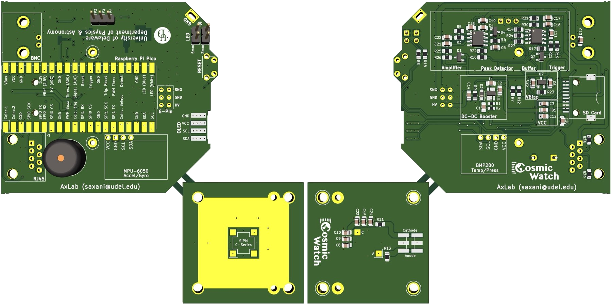

Building a v3X takes four steps:

1. Buy the parts and order the circuit boards.
2. [Populate the boards](/docs/build/populate-the-boards/).
3. [Mount the SiPM and wrap the scintillator](/docs/build/sipm-and-scintillator/).
4. [Flash the firmware and take your first data](/docs/build/firmware-and-first-run/).

A first-time builder usually needs about four hours of bench time. Your second detector goes much faster.

## Parts

Everything is on the purchasing list in the repository, with quantities, prices for 1 and 10 units, and a link for each part. The [Buy a detector](/purchase/) page shows the same list as a table.

- Most parts are standard and can be swapped for equivalents. The SiPM is the exception: get the one on the list.
- The plastic scintillator is the hardest part to find. The list links to a seller.
- Some parts only come in bulk. One tube of optical gel covers about 50 detectors.
- The case and faceplates are optional but protect the detector.

## Circuit boards

Send `PCB/PCB_Gerber_Files_v28.zip` to any board house. The boards are two-layer, 10 × 10 cm. The lab uses Elecrow, and boards take about two weeks to arrive. The main board and the small SiPM board come as one panel and snap apart.

## Tools

A temperature-controlled soldering iron, fine solder, tweezers, a multimeter, and black electrical tape and aluminum foil for wrapping. An oscilloscope helps for testing but is not required. The lab uses a Hakko FX888D iron at about 750 °F with Kester 0.031" leaded solder.

{/* full-guide-link: generated, safe to re-run */}

:::note[Full text]
The complete text, with every figure, is in the Instruction Manual: [(1) Purchasing the components](/docs/guides/instruction-manual/how-to-build-a-cosmicwatch-detector-v3x/#1-purchasing-the-components).
:::
