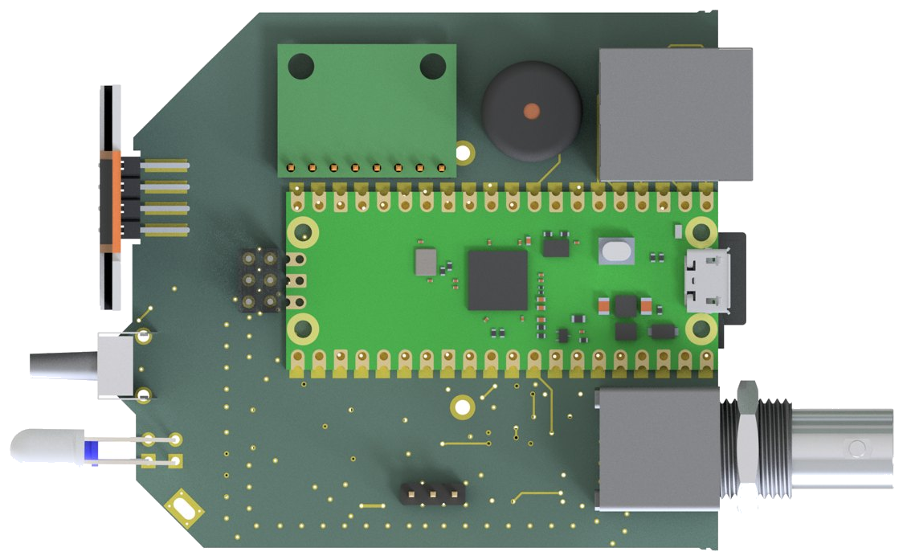

Almost every part is an **0805 surface-mount** component, 0.08 × 0.05 inches. They look tiny at first and become routine after a few.

The [component placement sheet](https://github.com/spenceraxani/CosmicWatch-Desktop-Muon-Detector-v3X/blob/main/Component_Placement_Sheet.xlsx) lists every part and the order to place them. It starts with easy parts and builds the board in stages, with checks along the way.

## Reading the board

Parts are labeled R (resistors), C (capacitors), L (inductors), U (chips) and D (diodes). Larger parts like the Pico, the pressure sensor and the OLED are outlined on the silkscreen. **Put each part on the side of the board that has its silkscreen outline.**

Resistors, capacitors and inductors can go either way. Diodes and chips have a direction; it is marked on the placement sheet.

## The routine for every part

Move the board, not your hands, so each joint is comfortable.

1. Find the part's footprint on the board.
2. Put a little solder on **one** pad.
3. Hold the part flat with tweezers next to the footprint.
4. Melt that solder and slide the part into place.
5. Remove the iron, let it set, then let go.
6. Check that it is flat and the right way round. If not, reheat the one joint and fix it.
7. Solder the other pads.
8. Go back and add fresh solder to the first pad.

Fresh solder fixes most problems: spikes, dull cold joints, even removing a part.

If a check on the placement sheet fails, the cause is almost always a missing or weak joint rather than a wrong part. Reflow the joints in that section first.

{/* full-guide-link: generated, safe to re-run */}

:::note[Full text]
The complete text, with every figure, is in the Instruction Manual: [(2) Populating the PCBs](/docs/guides/instruction-manual/how-to-build-a-cosmicwatch-detector-v3x/#2-populating-the-pcbs).
:::
