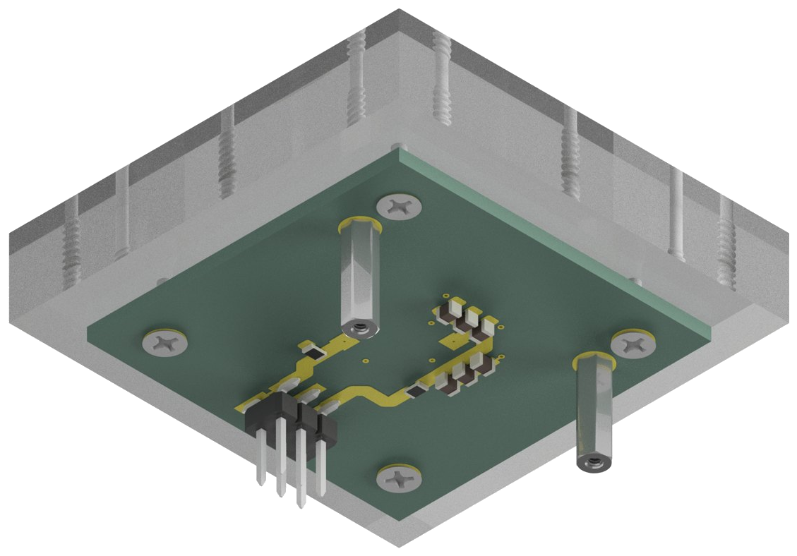

## Orientation

Line up **pin 1** of the SiPM with the white L-shaped mark on the SiPM board (lower left relative to the text). Pin 1 is the one with an extra metal tab sticking out sideways. Page 10 of the onsemi MicroFC datasheet shows it if you are unsure.

## Soldering it

1. Put a small bump of solder on pad 1.
2. Pick up the SiPM with your fingers, not tweezers, which can scratch the face.
3. Line it up exactly with the outline, then heat the bump so it settles flat.
4. Check alignment. If it is off, reheat pad 1 and adjust.
5. Solder the remaining pads. The solder flows under the SiPM.

## Test before you wrap

The SiPM behaves like a diode. Put a multimeter in diode mode, red lead on the anode and black on the cathode (both marked on the back of the board). You should read about **0.5 V**. If not, check orientation, check the joints, or swap the leads.

Do this now. Unwrapping the scintillator later to fix a bad joint takes a long time.

## Wrapping

The SiPM is coupled to the scintillator with optical gel, then the slab is wrapped in aluminum foil and black electrical tape so that no outside light gets in. Even a pinhole leak shows up as noise. The [Instruction Manual](https://github.com/spenceraxani/CosmicWatch-Desktop-Muon-Detector-v3X/blob/main/The%20Instruction%20Manual.pdf) covers the wrapping in detail.

{/* full-guide-link: generated, safe to re-run */}

:::note[Full text]
The complete text, with every figure:

- Instruction Manual: [How to build a CosmicWatch detector v3X](/docs/guides/instruction-manual/how-to-build-a-cosmicwatch-detector-v3x/)
- Physics Document: [Scintillators](/docs/guides/physics/detection-methods/#scintillators)
:::
