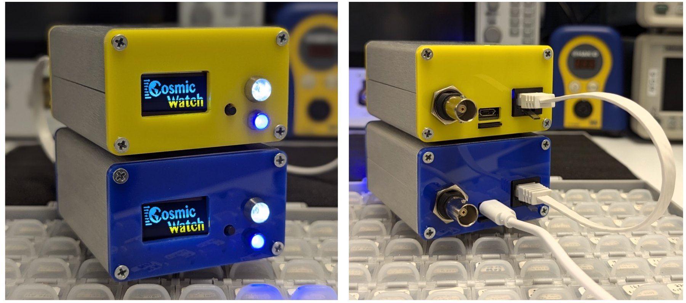

On its own, a detector counts anything that leaves enough energy in the scintillator, and at sea level most of that is natural radioactivity. Two detectors linked together can tell when a particle went through **both**, which is almost always a cosmic-ray muon.

## Setting it up

1. Connect the two detectors with an ordinary network cable (the coincidence cable). Only one needs USB power; the other is powered through the cable.
2. Reset both detectors within about a second of each other, or unplug and replug the power.
3. Both front LEDs light up brightly for one second when they find each other.

Every event is still recorded. Events seen by both detectors get a `1` in the coincidence column, and the OLED shows both the total and coincidence rates. The smaller blue LED flashes on coincident events.

## Why it works

- **Alpha particles** cannot get through the case or even the tape.
- **Beta particles** lose energy in the aluminum and tape, and rarely make it through one detector with enough energy to trigger a second.
- **Gamma rays** pass through, but would have to scatter in one scintillator and then interact in the other. It happens, but rarely, and those events are dimmer on average.
- **Accidental coincidences** between two unrelated events are rare. With both detectors at about 3 Hz, the accidental rate is around 54 µHz.
- **Muons** cross both slabs easily and leave 1.5 to 2 MeV in each, so they are bright as well as coincident.

Below about 5 km altitude, and especially under 15 cm or more of concrete, coincident events are overwhelmingly muons.

{/* full-guide-link: generated, safe to re-run */}

:::note[Full text]
The complete text, with every figure:

- Instruction Manual: [Setting detectors in coincidence mode](/docs/guides/instruction-manual/the-cosmicwatch-desktop-muon-detector-v3x/#setting-detectors-in-coincidence-mode)
- Physics Document: [Accidental coincident events](/docs/guides/physics/additional-things-you-should-know/#accidental-coincident-events)
:::
