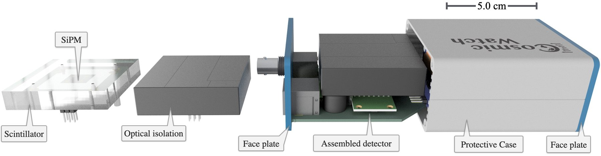
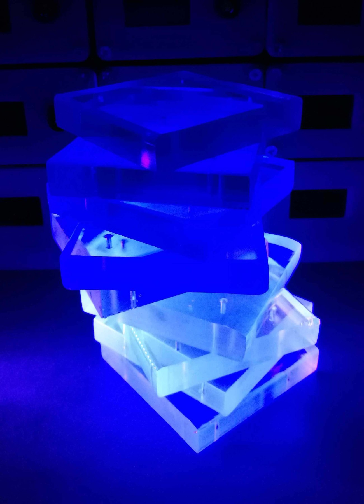
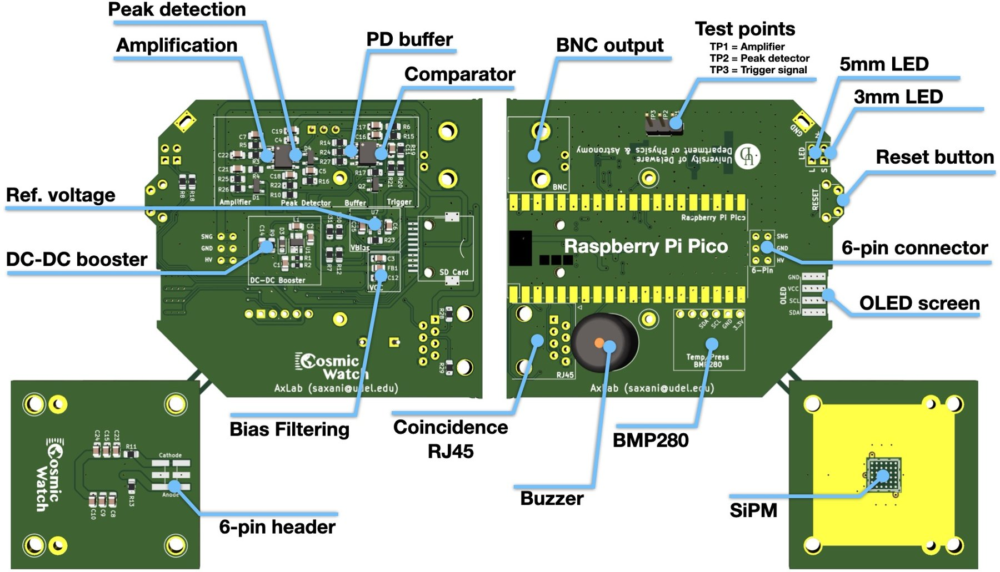

The v3X is a 5 × 5 × 1 cm slab of plastic scintillator read out by a single silicon photomultiplier (SiPM), with custom electronics and a Raspberry Pi Pico.

## 1. Light in the scintillator

When a charged particle crosses the scintillator it leaves some of its energy behind, and part of that energy comes back out as light, roughly one photon for every 100 eV deposited. A muon crossing 1 cm of plastic typically deposits about 2 MeV.

The slab is wrapped in aluminum foil and black tape so that only light from inside reaches the sensor.

## 2. Counting photons with the SiPM

The SiPM is a grid of tiny photodiodes (microcells) biased just above breakdown. One photon can fire one microcell, and each fired cell adds a small, fixed pulse of current. The total current tells you roughly how many photons arrived, and so how much energy the particle left.

The v3X uses an onsemi MicroFC-60035 SiPM with a 6 × 6 mm active area. It is the most expensive part of the detector.

## 3. Shaping and triggering

The main board amplifies the SiPM pulse and splits it three ways:

- a **comparator** fires a hardware trigger as soon as the pulse crosses threshold (about 4 mV),
- a **peak detector** holds a fraction of the pulse height long enough for the Pico's 12-bit ADC to read it,
- and once the event is recorded, a MOSFET resets the peak detector, ready for the next pulse.

The whole cycle takes about 400 µs, so the detector can record up to 700 events per second.

## 4. What gets logged

For each event the Pico records the event number, time since start, the coincidence flag, the ADC value, the calculated SiPM pulse height in mV, the total dead time, temperature, pressure, and acceleration and rotation on three axes. See [Recording data](/docs/recording-data/) for the column format.

The board also has a 0.96" OLED screen, two LEDs (one for every event, one for coincident events), a buzzer, a microSD slot, an RJ45 port for [coincidence mode](/docs/coincidence-mode/), and a BNC connector wired straight to the SiPM so you can look at raw pulses on an oscilloscope.

## Power and size

One detector draws about 0.5 W from any USB source between 1.8 V and 5.5 V. Without the case it weighs 83 g; with the aluminum case it is 110 g and 66.4 × 70.0 × 39.9 mm.

{/* full-guide-link: generated, safe to re-run */}

:::note[Full text]
The complete text, with every figure:

- Instruction Manual: [Introduction to the Detector](/docs/guides/instruction-manual/the-cosmicwatch-desktop-muon-detector-v3x/#introduction-to-the-detector)
- Instruction Manual: [Detailed description of the electronics](/docs/guides/instruction-manual/detailed-description-of-the-electronics/)
- Physics Document: [Detection methods](/docs/guides/physics/detection-methods/)
:::
