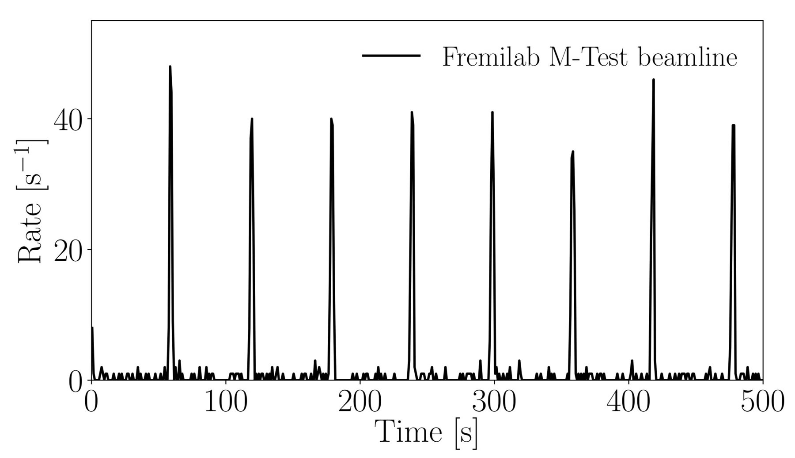

**Use a detector as a cheap beam monitor.**

## What you need

- One or two detectors
- Access to a test beam

## How it was done

In the Fermilab test beam, a detector placed in the beam saw a sharp spike in its rate each time a spill of particles arrived. Because the detector is small and self-powered, it works as a quick, portable trigger or beam monitor.

---

From section 2.16 of *The Example Measurements* (CosmicWatch v3X, August 2025). The full write-up, with plots and equations, is in the [GitHub repository](https://github.com/spenceraxani/CosmicWatch-Desktop-Muon-Detector-v3X/blob/main/The%20Example%20Measurements.pdf).

{/* full-guide-link: generated, safe to re-run */}

:::note[Full text]
The complete text, with every figure, is in the Example Measurements: [Portable trigger system for an accelerator beamline](/docs/guides/example-measurements/tested-measurements/portable-trigger-system-for-an-accelerator-beamline/).
:::
