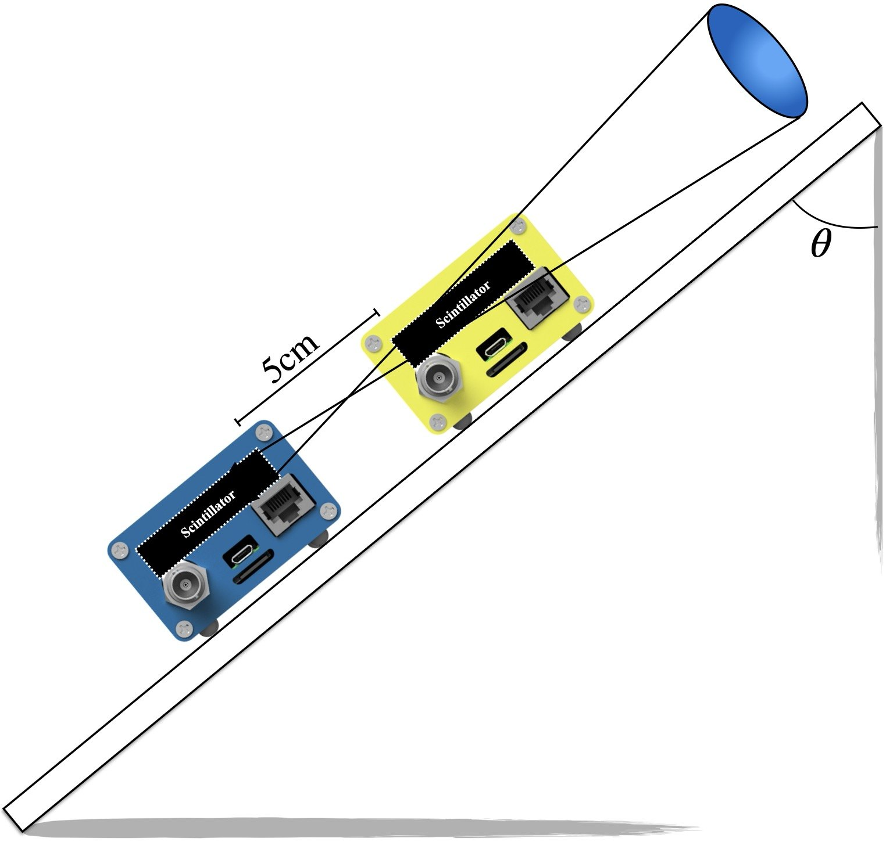

**Tilt a coincidence pair and watch the rate follow the cos² law.**

## What you need

- Two detectors in coincidence mode
- A 40 cm bar or board to mount them on
- About a day of data per angle

## How it was done

Two detectors sat side by side in coincidence mode, 50 mm apart, mounted on a 40 cm bar. Leaning the bar against a wall at a known height sets the zenith angle θ. Each angle got about 24 hours of data.

At sea level, muon intensity falls off roughly as cos²θ, so the rate drops as the pair tips toward horizontal. On top of that sit a flat accidental rate (about 4.5 × 10⁻⁵ Hz for single rates of 3.3 Hz and 2.9 Hz and a 2.3 µs window) and a small offset from air showers, where several muons from one cosmic ray hit both detectors at once.

At θ = 90° the rate rises slightly, because a horizontal pair accepts muons from both directions.

---

From section 2.2 of *The Example Measurements* (CosmicWatch v3X, August 2025). The full write-up, with plots and equations, is in the [GitHub repository](https://github.com/spenceraxani/CosmicWatch-Desktop-Muon-Detector-v3X/blob/main/The%20Example%20Measurements.pdf).

{/* full-guide-link: generated, safe to re-run */}

:::note[Full text]
The complete text, with every figure, is in the Example Measurements: [Cosmic-ray muon angular dependence](/docs/guides/example-measurements/tested-measurements/cosmic-ray-muon-angular-dependence/).
:::
