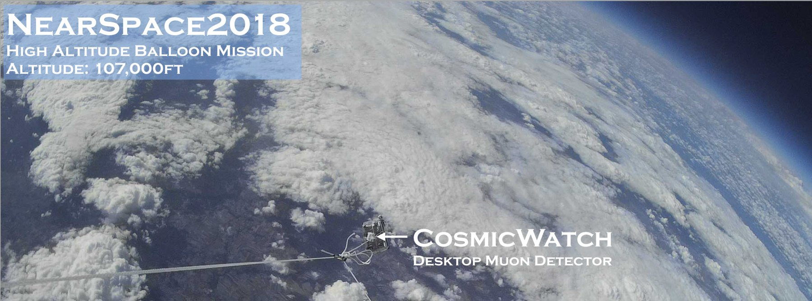

**The v2-era flight that first mapped the rate up to the stratosphere.**

## What you need

- A pair of detectors
- A balloon launch

## How it was done

In September 2018, a team from Poland's National Centre for Nuclear Research launched two CosmicWatch detectors on a weather balloon during the Near Space 2018 conference in Toruń. The balloon reached about 32 km before it burst, and the data came back on the detectors' memory cards.

It was one of the first flights to show the full rise and fall of the cosmic-ray rate with altitude using these detectors. The v3X balloon flight repeats it with onboard pressure and motion data.

---

From section 2.14 of *The Example Measurements* (CosmicWatch v3X, August 2025). The full write-up, with plots and equations, is in the [GitHub repository](https://github.com/spenceraxani/CosmicWatch-Desktop-Muon-Detector-v3X/blob/main/The%20Example%20Measurements.pdf).

{/* full-guide-link: generated, safe to re-run */}

:::note[Full text]
The complete text, with every figure, is in the Example Measurements: [High altitude balloon measurement at 107,000 ft](/docs/guides/example-measurements/tested-measurements/high-altitude-balloon-measurement-at-107000-ft/).
:::
