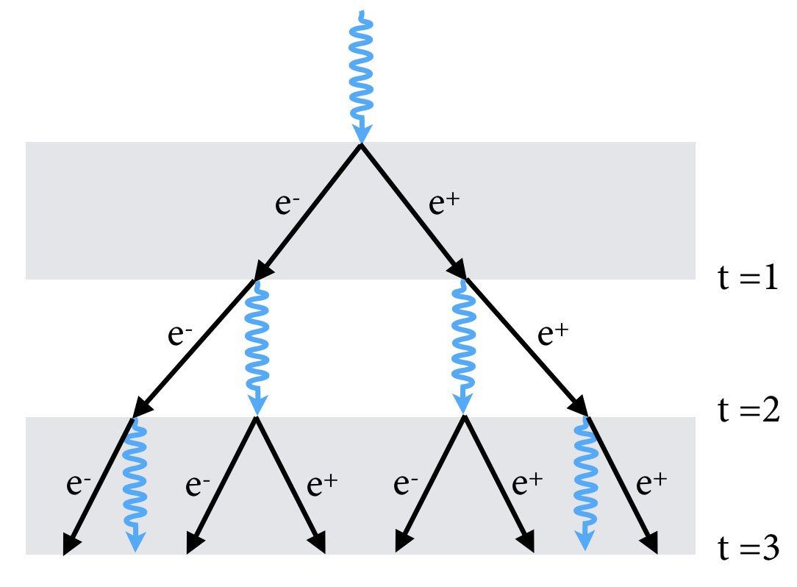

**Compare a rooftop to five floors down.**

## What you need

- Two detectors in coincidence mode
- A tall building with a roof you can use
- A plastic bag for weather

## How it was done

At sea level, cosmic-ray showers bring down electrons and positrons as well as muons. The electrons are easy to stop: concrete has a radiation length of about 10.7 cm, and a floor is about 15 cm thick.

A stacked coincidence pair logged for 24 hours on the roof of a 10-story building, then for another 24 hours on the 5th floor. The rooftop rate was 27% higher. Muons barely notice five floors, so most of the difference is the electromagnetic component being absorbed.

---

From section 2.8 of *The Example Measurements* (CosmicWatch v3X, August 2025). The full write-up, with plots and equations, is in the [GitHub repository](https://github.com/spenceraxani/CosmicWatch-Desktop-Muon-Detector-v3X/blob/main/The%20Example%20Measurements.pdf).

{/* full-guide-link: generated, safe to re-run */}

:::note[Full text]
The complete text, with every figure, is in the Example Measurements: [Electromagnetic component of cosmic-ray showers](/docs/guides/example-measurements/tested-measurements/electromagnetic-component-of-cosmic-ray-showers/).
:::
