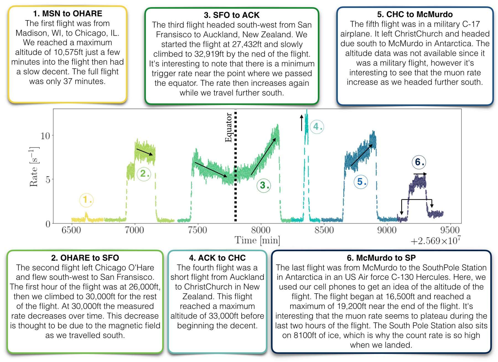

**Six flights, one power bank, and a clear latitude effect.**

## What you need

- Two detectors in coincidence mode
- A large power bank
- Flight altitude data, if you can get it

## How it was done

In December 2018 the detectors went along on a trip to service the IceCube Neutrino Observatory: commercial flights from Madison to Christchurch, then military flights to McMurdo Station and on to the South Pole. A single 30,000 mAh power bank ran both detectors the whole way.

The rate climbs with altitude on every flight. It is also lower near the equator, because Earth's magnetic field deflects more of the incoming cosmic rays there. The effect is not symmetric about the geographic equator, since the magnetic equator is offset from it.

While crossing the equator at 35,000 ft, an east-west comparison showed about 22% more particles arriving from the west, the classic east-west asymmetry.

---

From section 2.3 of *The Example Measurements* (CosmicWatch v3X, August 2025). The full write-up, with plots and equations, is in the [GitHub repository](https://github.com/spenceraxani/CosmicWatch-Desktop-Muon-Detector-v3X/blob/main/The%20Example%20Measurements.pdf).

{/* full-guide-link: generated, safe to re-run */}

:::note[Full text]
The complete text, with every figure, is in the Example Measurements: [Muon rate measurement while flying to the South Pole](/docs/guides/example-measurements/tested-measurements/muon-rate-measurement-while-flying-to-the-south-pole/).
:::
