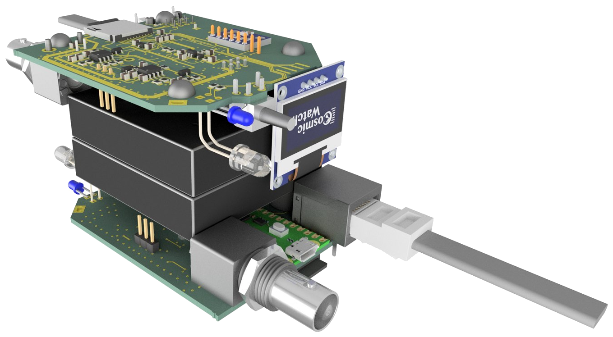

**Stack two detectors, log for a day, and separate muons from background by pulse height.**

## What you need

- Two v3X detectors and a coincidence (network) cable
- Two microSD cards
- A USB power source

## How it was done

Two v3X detectors were stacked face to face (configuration d) in the basement of Sharp Lab, which accepts muons from almost the whole sky. They logged to microSD cards for 26.9 hours.

The pair recorded a total trigger rate of 2.423 ± 0.005 Hz and a coincidence rate of 0.315 ± 0.002 Hz. Dead time was only 0.1% of the live time, about 408 µs per event.

The pulse-height spectrum shows a bump near 21 mV from muons crossing the 1 cm scintillator, which deposit about 2 MeV. Above roughly 18 mV, coincident events (muons) dominate. Below that, it is mostly natural radioactivity.

**Try next:** plot the rate in four-minute bins next to the onboard pressure and temperature. That is the starting point for the barometric measurement.

---

From section 2.1 of *The Example Measurements* (CosmicWatch v3X, August 2025). The full write-up, with plots and equations, is in the [GitHub repository](https://github.com/spenceraxani/CosmicWatch-Desktop-Muon-Detector-v3X/blob/main/The%20Example%20Measurements.pdf).

{/* full-guide-link: generated, safe to re-run */}

:::note[Full text]
The complete text, with every figure, is in the Example Measurements: [A full-sky cosmic-ray muon measurement](/docs/guides/example-measurements/tested-measurements/a-full-sky-cosmic-ray-muon-measurement/).
:::
