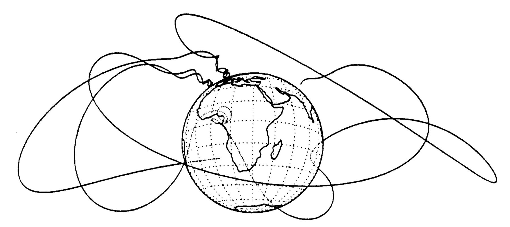

**Fit a simple model to flight data, then use it to estimate altitude.**

## What you need

- Rate data from flights with known altitude and latitude

## How it was done

Using the four commercial flights and a point after landing at the South Pole, the rate was fit with a simple model: an exponential in altitude whose strength depends on the sine squared of the (magnetic) latitude, plus a constant background.

The fitted model can then be turned around. For the two military flights, where no altitude data was published, the measured rate gives an estimate of the plane's altitude that lines up with the few GPS readings taken on board.

It is a good exercise in building an empirical model from messy real-world data.

---

From section 2.4 of *The Example Measurements* (CosmicWatch v3X, August 2025). The full write-up, with plots and equations, is in the [GitHub repository](https://github.com/spenceraxani/CosmicWatch-Desktop-Muon-Detector-v3X/blob/main/The%20Example%20Measurements.pdf).

{/* full-guide-link: generated, safe to re-run */}

:::note[Full text]
The complete text, with every figure, is in the Example Measurements: [Latitude correction to the cosmic-ray muons](/docs/guides/example-measurements/tested-measurements/latitude-correction-to-the-cosmic-ray-muons/).
:::
