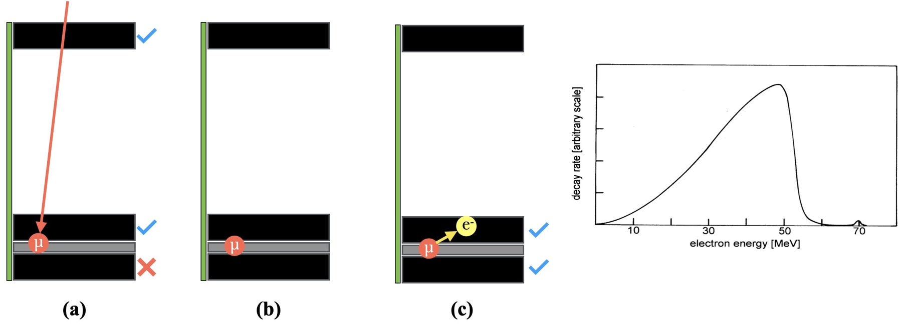

:::caution[Not tried yet]
This is an idea for the adventurous. Nobody has published a CosmicWatch result for it yet, so expect to work things out as you go.
:::

**Catch muons that stop in the scintillator and decay.**

## What you need

- One or more detectors
- Patience: stopped muons are rare in 1 cm of plastic

## How it was done

A muon that stops in the scintillator decays about 2.2 µs later on average, giving a second flash. Look for pairs of events a few microseconds apart and fit the distribution of time differences with an exponential.

The thin scintillator makes stopped muons rare, so this takes a lot of data and careful handling of accidental pairs.

---

From section 3.2 of *The Example Measurements* (CosmicWatch v3X, August 2025). The full write-up, with plots and equations, is in the [GitHub repository](https://github.com/spenceraxani/CosmicWatch-Desktop-Muon-Detector-v3X/blob/main/The%20Example%20Measurements.pdf).

{/* full-guide-link: generated, safe to re-run */}

:::note[Full text]
The complete text, with every figure, is in the Example Measurements: [Muon lifetime](/docs/guides/example-measurements/untested-measurements-for-the-adventurous/#muon-lifetime).
:::
