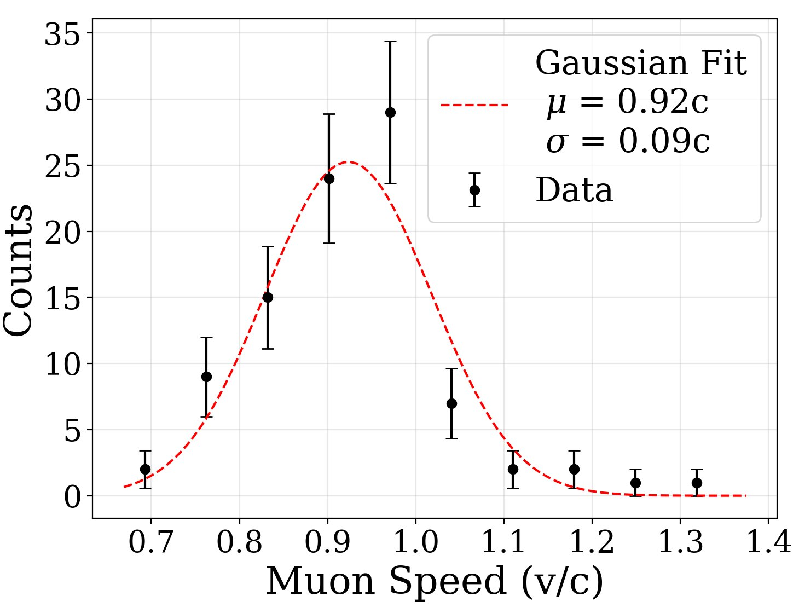

**Time-of-flight between two detectors three meters apart.**

## What you need

- Two detectors
- A fast oscilloscope (the test used 200 MHz, 2.5 GSa/s)
- Equal-length BNC cables

## How it was done

Two detectors were placed 2.97 m apart vertically, with their BNC outputs going to an oscilloscope. Whenever both channels crossed 5 mV, the scope saved both waveforms. Fitting each pulse with a template gives the arrival times, and the time difference gives the speed.

Over a week, 25 events had pulse separations under 10 ns. A Gaussian fit to the speeds gives 0.92 ± 0.09 c. The expected accidental rate in that window is about 0.1 events per week, so nearly every event is a real muon.

This is a measurement of something moving close to the speed of light, done on a lab bench.

---

From section 2.6 of *The Example Measurements* (CosmicWatch v3X, August 2025). The full write-up, with plots and equations, is in the [GitHub repository](https://github.com/spenceraxani/CosmicWatch-Desktop-Muon-Detector-v3X/blob/main/The%20Example%20Measurements.pdf).

{/* full-guide-link: generated, safe to re-run */}

:::note[Full text]
The complete text, with every figure, is in the Example Measurements: [Cosmic-ray muon velocity](/docs/guides/example-measurements/tested-measurements/cosmic-ray-muon-velocity/).
:::
