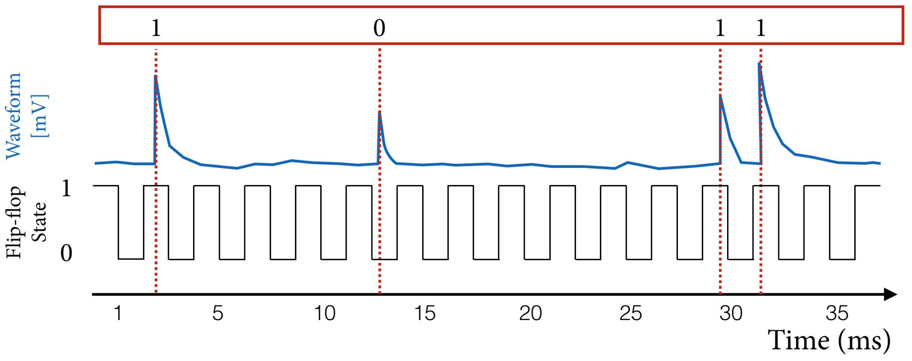

**Turn particle arrival times into random bits.**

## What you need

- One detector
- A computer to collect the bits

## How it was done

Computer random numbers usually come from an algorithm, so they are predictable if you know the starting point. Particle arrival times are truly random.

The idea: a flip-flop toggles every millisecond. When an event arrives during an even state you record a 1, otherwise a 0. String the bits together and you have random numbers you can test for bias and patterns.

---

From section 2.11 of *The Example Measurements* (CosmicWatch v3X, August 2025). The full write-up, with plots and equations, is in the [GitHub repository](https://github.com/spenceraxani/CosmicWatch-Desktop-Muon-Detector-v3X/blob/main/The%20Example%20Measurements.pdf).

{/* full-guide-link: generated, safe to re-run */}

:::note[Full text]
The complete text, with every figure, is in the Example Measurements: [A true random number generator?](/docs/guides/example-measurements/tested-measurements/a-true-random-number-generator/).
:::
