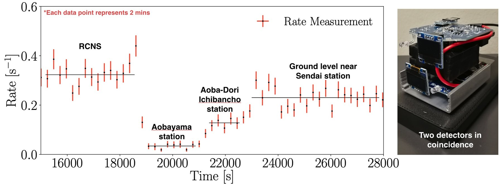

**Take a detector underground and watch the rate drop.**

## What you need

- One or two detectors on battery power
- Access to a deep underground space

## How it was done

While visiting Tohoku University in Sendai, Japan, the team took a detector into the very deep Aobayama subway station for about 30 minutes, then into a second station, then back up to ground level.

The drop in rate underground was surprisingly large. Turned around, the rate tells you how much rock is overhead, which physicists report in meters of water equivalent.

Deep stations in the US include Washington Park in Portland (79 m) and Forest Glen near Washington, DC. Remember that most muons arrive at an angle, so the rock off to the sides matters too.

---

From section 2.7 of *The Example Measurements* (CosmicWatch v3X, August 2025). The full write-up, with plots and equations, is in the [GitHub repository](https://github.com/spenceraxani/CosmicWatch-Desktop-Muon-Detector-v3X/blob/main/The%20Example%20Measurements.pdf).

{/* full-guide-link: generated, safe to re-run */}

:::note[Full text]
The complete text, with every figure, is in the Example Measurements: [Cosmic-ray muon attenuation in a Subway station](/docs/guides/example-measurements/tested-measurements/cosmic-ray-muon-attenuation-in-a-subway-station/).
:::
