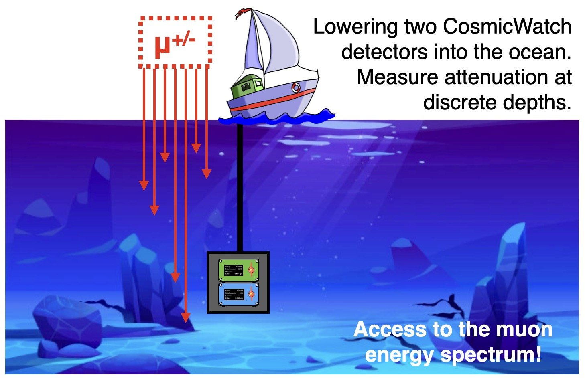

:::caution[Not tried yet]
This is an idea for the adventurous. Nobody has published a CosmicWatch result for it yet, so expect to work things out as you go.
:::

**Lower a sealed pair into a lake or the ocean.**

## What you need

- Two detectors in a watertight case
- A boat or dock and a measured line

## How it was done

Water is a perfectly known shield, which is why depth underground is quoted in meters of water equivalent. Lower a sealed coincidence pair to set depths and log the rate at each one.

Expect about a 30% drop in the first few feet as the electromagnetic part of the showers is absorbed, then a slow decline from the muons over tens of meters. Nobody has done this one with CosmicWatch yet.

---

From section 3.1 of *The Example Measurements* (CosmicWatch v3X, August 2025). The full write-up, with plots and equations, is in the [GitHub repository](https://github.com/spenceraxani/CosmicWatch-Desktop-Muon-Detector-v3X/blob/main/The%20Example%20Measurements.pdf).

{/* full-guide-link: generated, safe to re-run */}

:::note[Full text]
The complete text, with every figure, is in the Example Measurements: [Muon Rate Underwater](/docs/guides/example-measurements/untested-measurements-for-the-adventurous/#muon-rate-underwater).
:::
