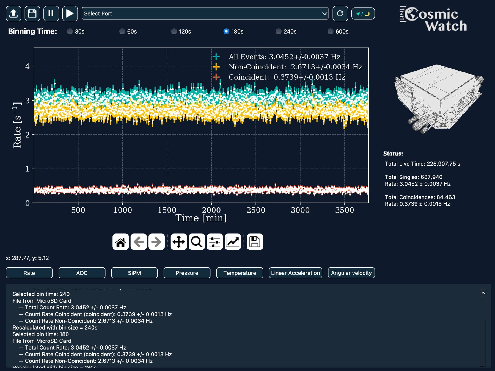
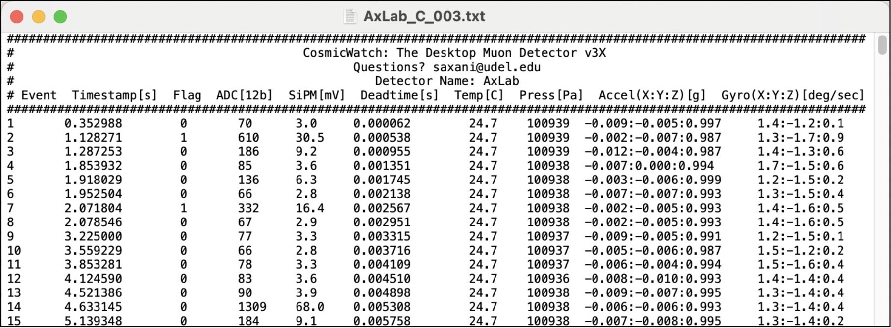

## Ways to record

1. **The OLED screen.** Shows run time, event count, average rate (corrected for dead time), the file name and the detector name. In coincidence mode it adds the coincidence count and rate. Good for a quick look.
2. **A microSD card (recommended).** The detector writes a new text file every time it powers on or resets. Format the card exFAT; a 4 GB card holds several months of data at sea level.
3. **`import_data.py` on a computer.** Plug in over USB (115200 baud), install `pyserial`, and run the script. Each event also gets a time stamp from your computer, which is far more accurate than the Pico's clock (it drifts about a minute per day).
4. **A serial monitor.** The Arduino IDE or VS Code's Serial Monitor extension shows the raw stream, including the diagnostics printed at boot. Useful for troubleshooting.
5. **The CosmicWatch GUI.** Plots rates, the pulse-height spectrum and the sensor data live, and opens old files. See [Software](/software/).

## File names

Files start with the detector name (set in `configure.txt` on the card, under 20 characters), then `C` if the detector booted in coincidence mode or `M` if not, then a number that counts up. `AxLab_C_002.txt` is the second coincidence-mode file from a detector named AxLab.

## Columns

Files are tab-separated text. Lines starting with `#` are comments.

| Column | Meaning |
| --- | --- |
| Event | Event number, counting up from 1 |
| Timestamp [s] | Run time since start (not live time). Only good to tens of seconds per day |
| Flag | `1` if the event was coincident with the linked detector, otherwise `0` |
| ADC [12b] | Raw 12-bit (0 to 4095) reading of the peak detector, referenced to 2.5 V |
| SiPM [mV] | Pulse height calculated from the ADC value; tracks deposited energy |
| Dead time [s] | Total dead time so far |
| Temp, Pressure | From the onboard BMP280 sensor |
| Accel, Gyro | Linear acceleration and angular velocity on x, y and z |

Data recorded through `import_data.py` adds the detector name and the computer's date and time. Each event takes 48 to 100 bytes.

The `Data/` folder in the repository has `plot.py`, which makes the pulse-height plot from an example file, and `import_data.py`.

{/* full-guide-link: generated, safe to re-run */}

:::note[Full text]
The complete text, with every figure, is in the Instruction Manual: [Recording data options](/docs/guides/instruction-manual/the-cosmicwatch-desktop-muon-detector-v3x/#recording-data-options).
:::
